# Active Directory & Help Desk Home Lab

A self-built company IT environment: **Windows Server 2025 Active Directory**, a domain-joined **Windows 11** client, and an **Ubuntu Linux** server running the **osTicket** help desk. Documented step by step, including the reasoning behind each decision and every problem I hit.

**Full write-up as PDF:** [docs/AD-Home-Lab-Build-Log.pdf](docs/AD-Home-Lab-Build-Log.pdf) · **PowerShell scripts:** [scripts/](scripts/)

## Overview

I built a small company IT environment from scratch in VirtualBox: an Active Directory domain, `lab.local`, a domain-joined Windows 11 workstation, and an Ubuntu Linux server running the osTicket help desk. On top of it I worked ten realistic help desk tickets end to end, from password resets and onboarding to Group Policy, DNS and PowerShell automation.

The goal is hands-on practice with the work an IT support or junior sysadmin role handles daily, documented with the reasoning behind each decision and the problems I hit along the way. The roadmap at the end shows what comes next.

**Skills demonstrated**

- Windows Server 2025: AD DS, DNS (forward and reverse zones), Group Policy
- User lifecycle: onboarding, offboarding, password resets, account lockouts
- Access control: OUs, security groups, AGDLP, NTFS and share permissions
- PowerShell: bulk user creation from CSV, auditing and fixing account data
- Security practice: least privilege, named admin accounts, UAC, lockout policy
- Identity and PKI: LDAP over StartTLS, an Enterprise Root CA (AD CS), certificate trust on Linux, CSR-based web certificates and HTTPS, a read-only service account
- Linux: Ubuntu Server administration over SSH, packages, services, permissions
- Web stack: Apache, MariaDB and PHP (LAMP) hosting the osTicket help desk, built from source where needed
- Help desk practice: ticket ownership, internal notes, data-owner approval, follow-up tasks, the full access lifecycle
- Troubleshooting: documented problems, causes and fixes throughout

## Lab environment

Three VMs share an isolated VirtualBox internal network, `labnet`, with no router. DC01 provides AD and DNS; CLIENT01 and HELPDESK01 use it as their DNS server. HELPDESK01 also has an outbound-only NAT adapter for software downloads.

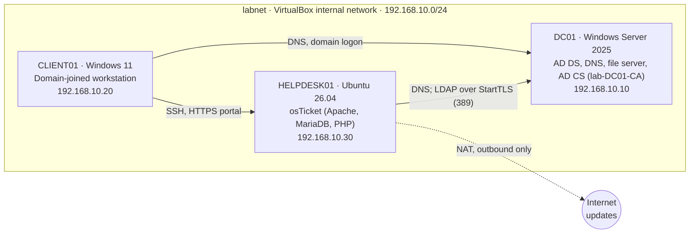

Every DNS lookup and login from CLIENT01 goes to DC01, which is why the client can't join or log in while DC01 is off.

| Item | Value |
| --- | --- |
| Host | Laptop, 16 GB RAM |
| Hypervisor | Oracle VirtualBox |
| Network | Internal Network `labnet`, 192.168.10.0/24, no gateway |
| Domain | `lab.local` (NetBIOS name `LAB`), single forest, single domain |

| VM | OS | Role | vCPU | RAM | Disk | IP address | DNS server |
| --- | --- | --- | --- | --- | --- | --- | --- |
| DC01 | Windows Server 2025 Standard Evaluation (Desktop Experience) | Domain controller, DNS, Global Catalog, file server, certificate authority (AD CS) | 2 | 4 GB | 60 GB | 192.168.10.10 (static) | 127.0.0.1 |
| CLIENT01 | Windows 11 Enterprise Evaluation | Domain-joined workstation | 2 | 4 GB | 64 GB | 192.168.10.20 (static) | 192.168.10.10 |
| HELPDESK01 | Ubuntu Server 26.04 LTS | osTicket help desk (Apache, MariaDB, PHP 8.4) with AD sign-in over LDAP/TLS, served over HTTPS | 2 | 2 GB | 25 GB | 192.168.10.30 (static) | 192.168.10.10 |

**Directory structure**

| OU path | Contents |
| --- | --- |
| Company\\Users\\IT | Alex Lee (`alee`) |
| Company\\Users\\HR | Jane Smith (`jsmith`) |
| Company\\Users\\Sales | John Brown (`jbrown`) |
| Company\\Groups | `IT-Staff`, `HR-Staff`, `Sales-Staff` (Global, Security) |
| Company\\Computers | CLIENT01 |

Users and computers sit in separate OUs so Group Policy can target each independently. Each user is a member of their department's group.

## Build steps

The build took 12 steps, from an empty VirtualBox install to a domain user logged in on CLIENT01. Usernames in file paths are blurred.

### Domain controller (DC01)

1. **Prepared the host.** Confirmed virtualization was enabled, installed VirtualBox, and downloaded the Windows Server 2025 and Windows 11 Enterprise evaluation ISOs from the Microsoft Evaluation Center.
2. **Created the DC01 VM.** 2 vCPU, 4 GB RAM, 60 GB disk, unattended installation skipped. Attached Adapter 1 to Internal Network `labnet`.

   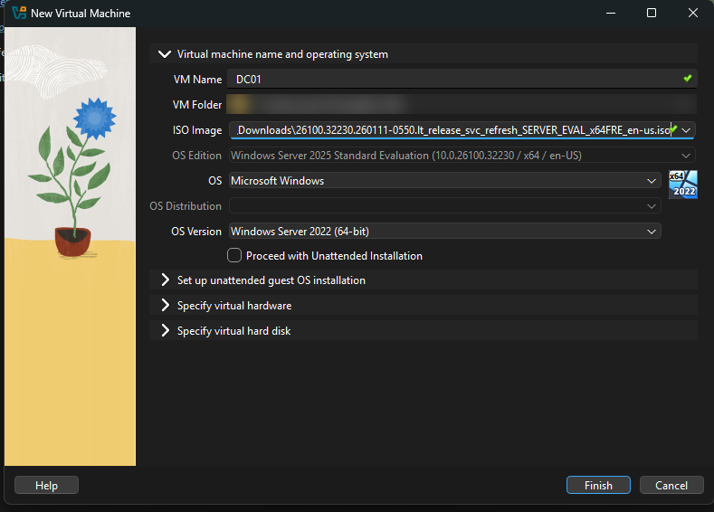
3. **Installed Windows Server 2025.** Chose *Standard Evaluation (Desktop Experience)* for the full GUI, and set the Administrator password.

   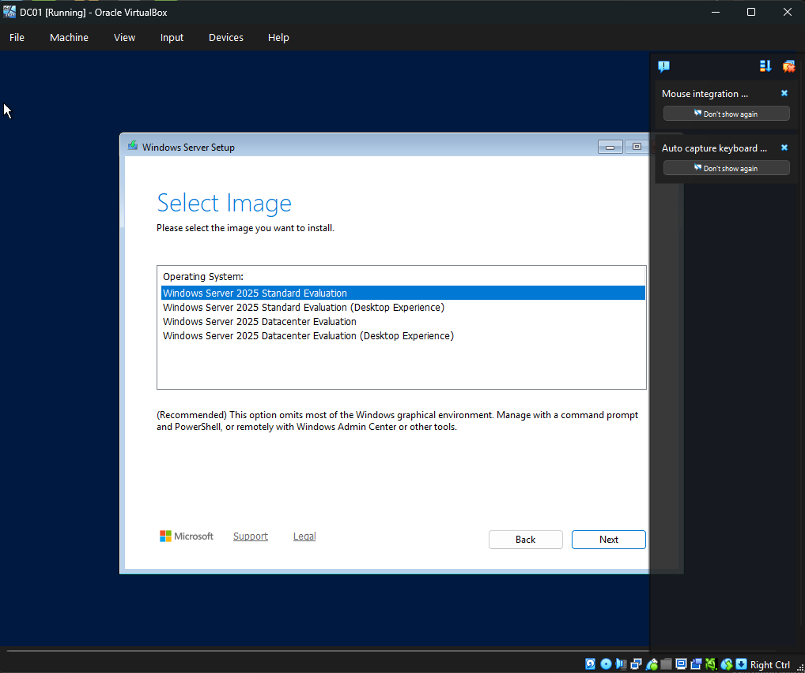
4. **Configured the base server.** Installed VirtualBox Guest Additions, set a static IP (192.168.10.10/24, DNS 127.0.0.1), set the time zone to UTC-04:00, and renamed the server to DC01 before promotion.

   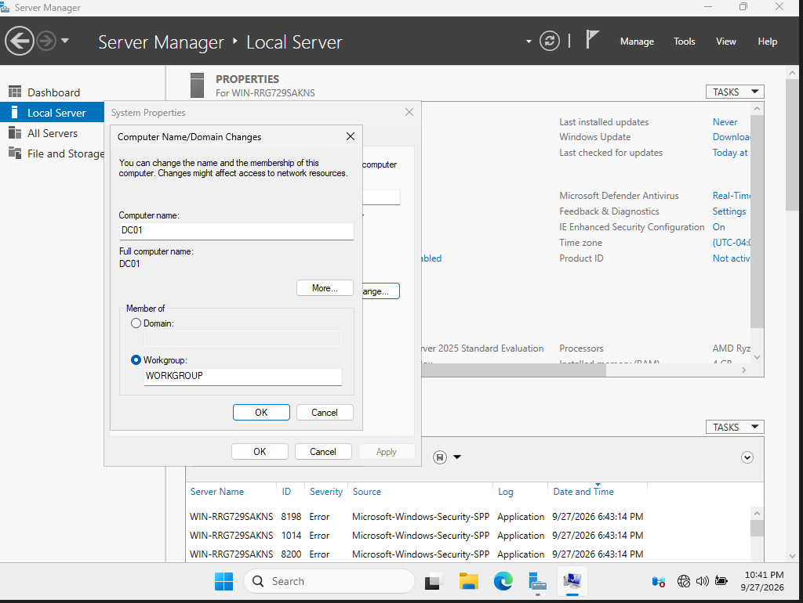

   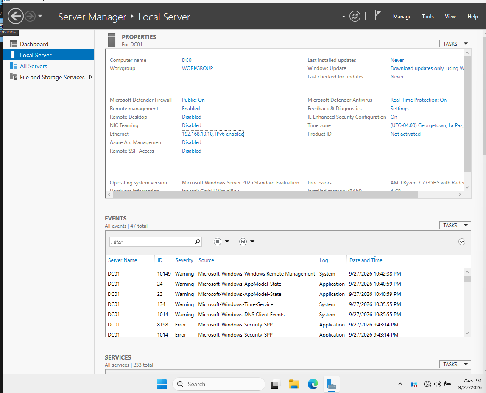
5. **Snapshot:** `Clean install - before AD`.
6. **Installed AD DS and promoted DC01.** Added the Active Directory Domain Services role, then promoted DC01 to a domain controller in a new forest, `lab.local`, with DNS and Global Catalog. NetBIOS name `LAB`. The server rebooted automatically.

   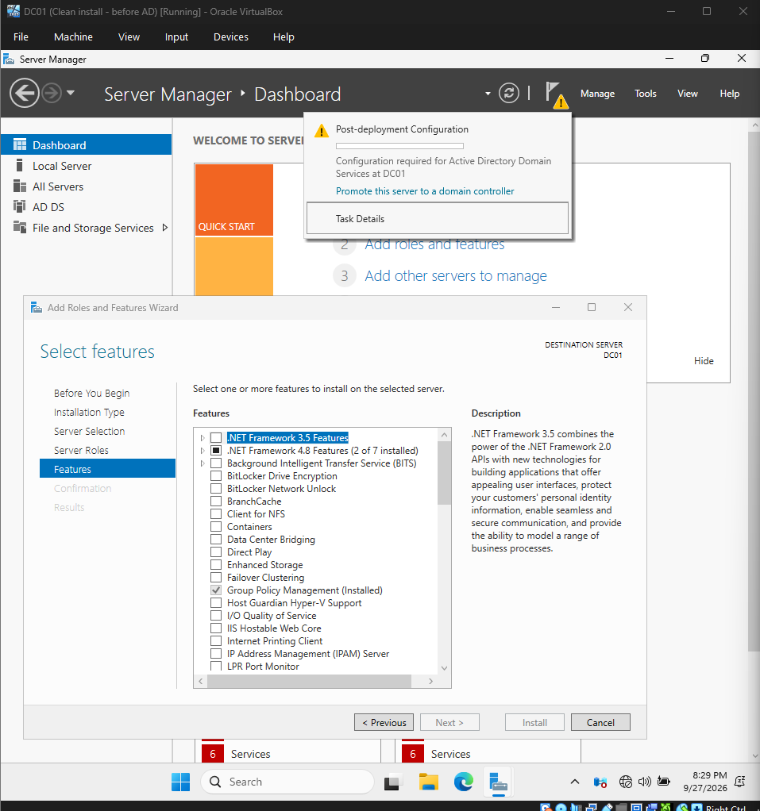

   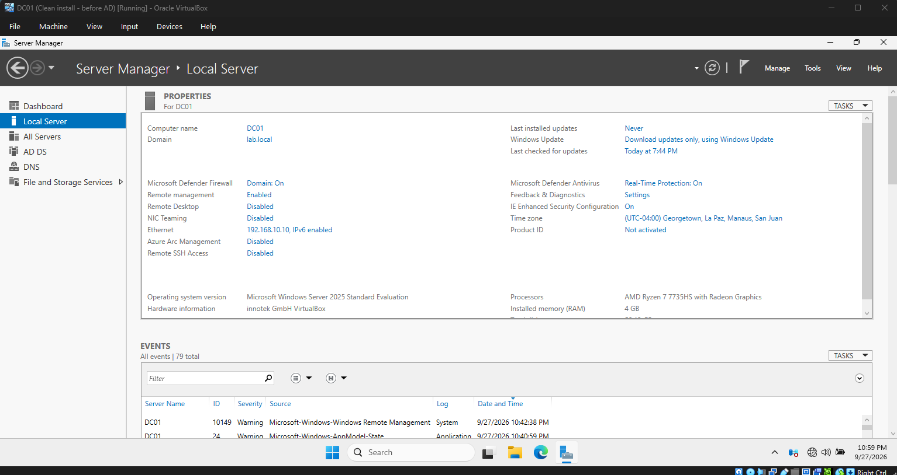
7. **Snapshot:** `AD installed - lab.local`.
8. **Built the OU structure, users and groups** in Active Directory Users and Computers, as listed under Lab environment. Added each user to their department group.

   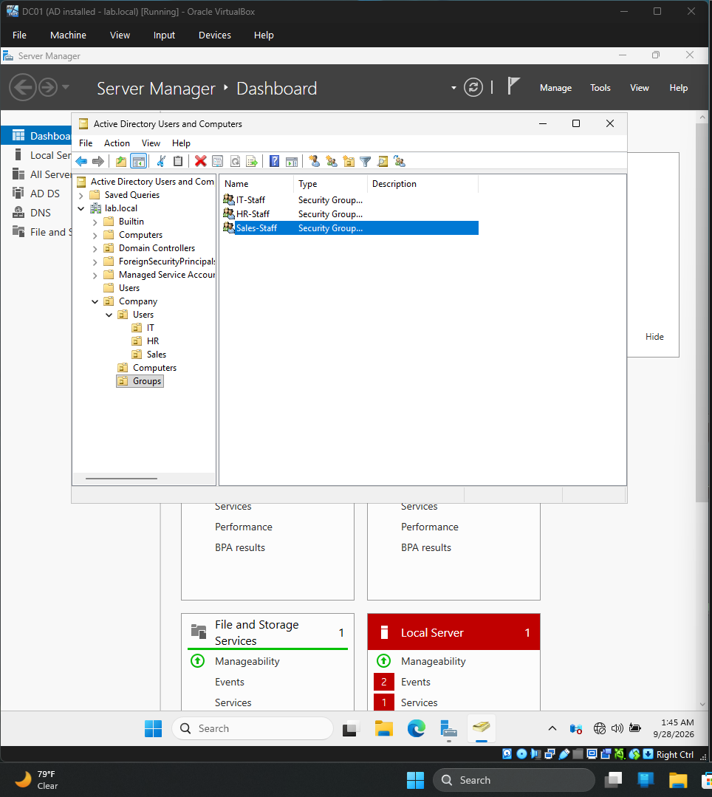

### Client (CLIENT01)

9. **Created the CLIENT01 VM.** 2 vCPU, 4 GB RAM, 64 GB disk, OS version Windows 11 (64-bit), which enables the virtual TPM 2.0, EFI and Secure Boot. Attached to `labnet`.

   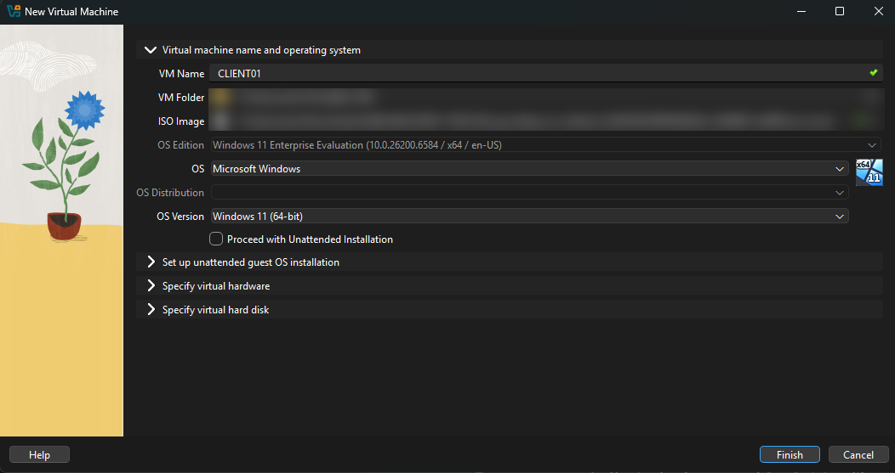

   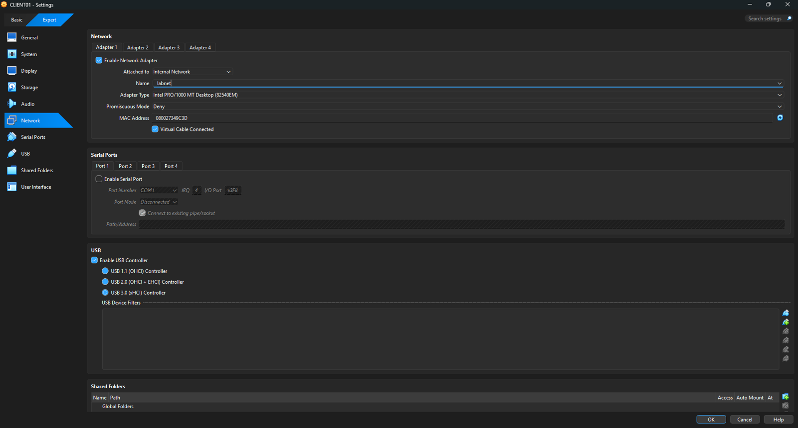
10. **Installed Windows 11 Enterprise** with a local account, `localadmin`. Installed Guest Additions.

    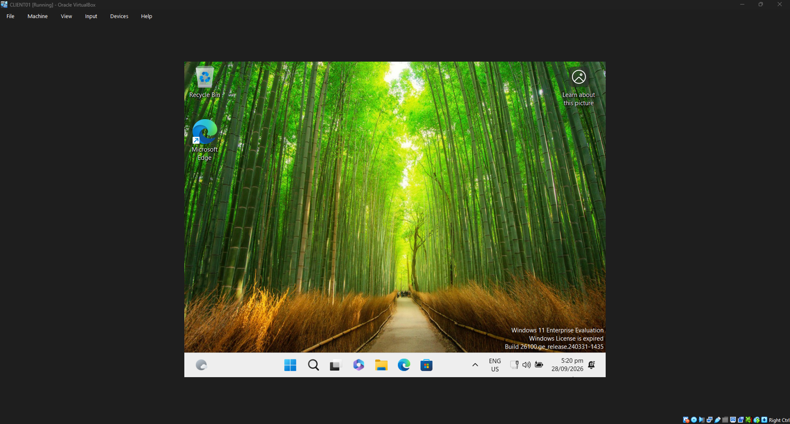
11. **Pointed the client at the domain.** Set a static IP (192.168.10.20/24, DNS 192.168.10.10) and confirmed with `nslookup lab.local`, which returned 192.168.10.10.

    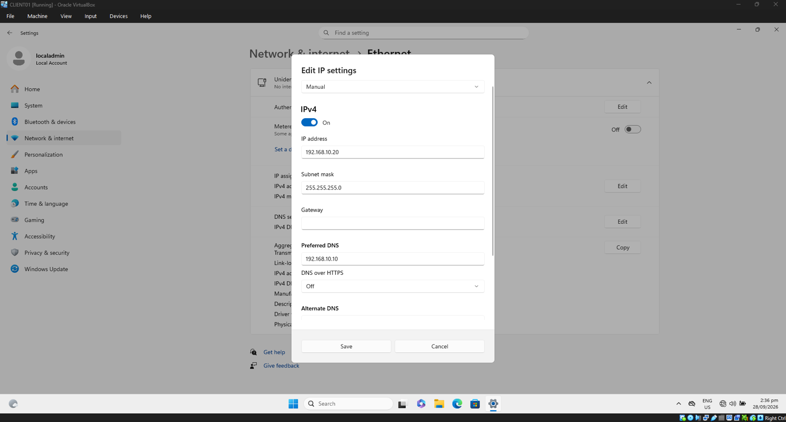

    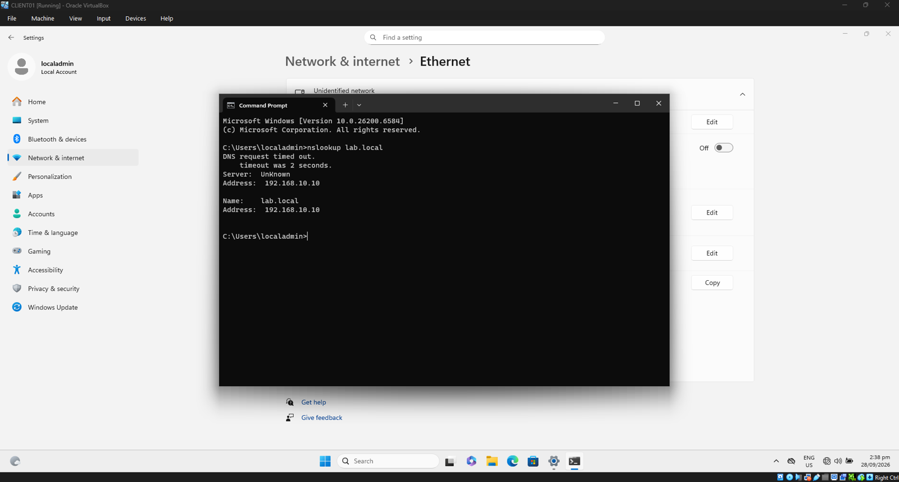
12. **Renamed and joined the domain.** Renamed to CLIENT01 and joined `lab.local` using domain Administrator credentials, then restarted. Logged in as `LAB\jsmith`, and moved the CLIENT01 computer object from the default Computers container to `Company\Computers`.

    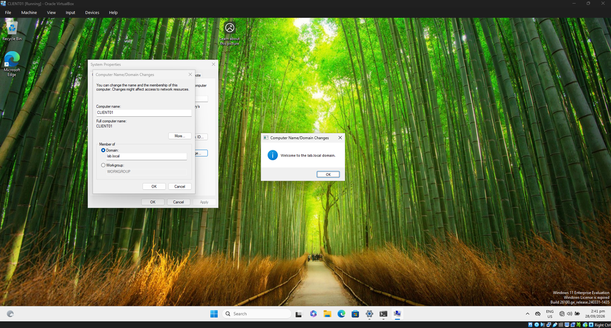

    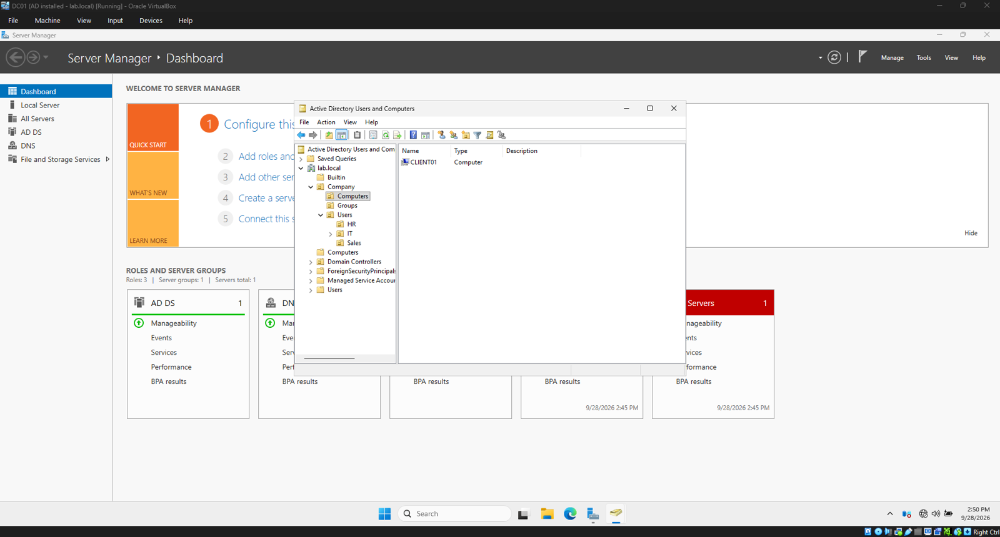

## Troubleshooting log

Eight issues came up during the build; seven were fixed and one is known and non-blocking. Each has an error screenshot where one was captured.

| # | Symptom | Cause | Fix |
| --- | --- | --- | --- |
| 1 | DC01 would not boot: "No bootable medium found". VM showed OS type Other/Unknown (32-bit). | Downloaded the wrong ISO: `SERVER_LOF_PACKAGES_OEM.iso` is the Languages and Optional Features disc, not an installer. | Downloaded the 64-bit `SERVER_EVAL` ISO, set the VM type to Microsoft Windows, 64-bit, and remounted it. *Screenshot below.* |
| 2 | Ctrl+Alt+Del opened the host's security screen instead of the VM's. | Windows on the host always intercepts Ctrl+Alt+Del. | Sent it with Input > Keyboard > Insert Ctrl-Alt-Del, or Host key (Right Ctrl) + Delete. |
| 3 | DC01 clock ran 3 hours ahead of real time. | VM clock not yet synced with the host. | Resolved after installing Guest Additions and rebooting. Matters because Kerberos logins fail when clocks differ by more than 5 minutes. |
| 4 | Promotion prerequisites check failed: "Role change is in progress or this computer needs to be restarted." | Started promotion before the AD DS role install had fully finished. | Restarted the server and reran promotion from the Server Manager flag. After the restart, Server Manager briefly showed Roles: 0 until it finished loading. *Screenshot below.* |
| 5 | CLIENT01 boot failed: "No bootable option or device was found." | Missed the 5-second "Press any key to boot from CD or DVD" prompt, so the VM tried the empty disk. | Remounted the ISO, restarted, and pressed a key at the prompt. *Screenshot below.* |
| 6 | `nslookup lab.local` on CLIENT01 timed out. | DC01 was powered off, so no DNS server answered. | Started DC01 and waited for DNS to load; the lookup then returned 192.168.10.10. The remaining "Server: UnKnown" line is expected with no reverse lookup zone. *Screenshot below.* |
| 7 | After "Welcome to the lab.local domain", an error said changing the Primary Domain DNS name failed. | Known Windows quirk when renaming and joining in one step. | No action needed: the join succeeded. Verified CLIENT01 in ADUC and `whoami` as `lab\jsmith`. *Screenshot below.* |
| 8 | CLIENT01 desktop shows "Windows License is expired". | The evaluation cannot activate without internet access. | Open, non-blocking. To revisit if it starts affecting the VM. |

### Error screenshots

**Issue 1:** the LOF ISO attached as the boot disc, so DC01 had nothing to boot from.

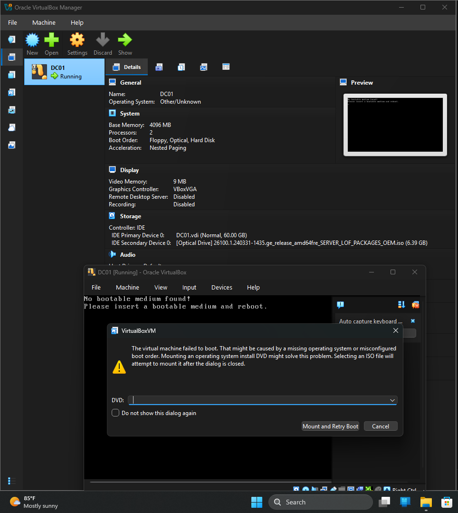

**Issue 4:** promotion blocked because the role install hadn't finished.

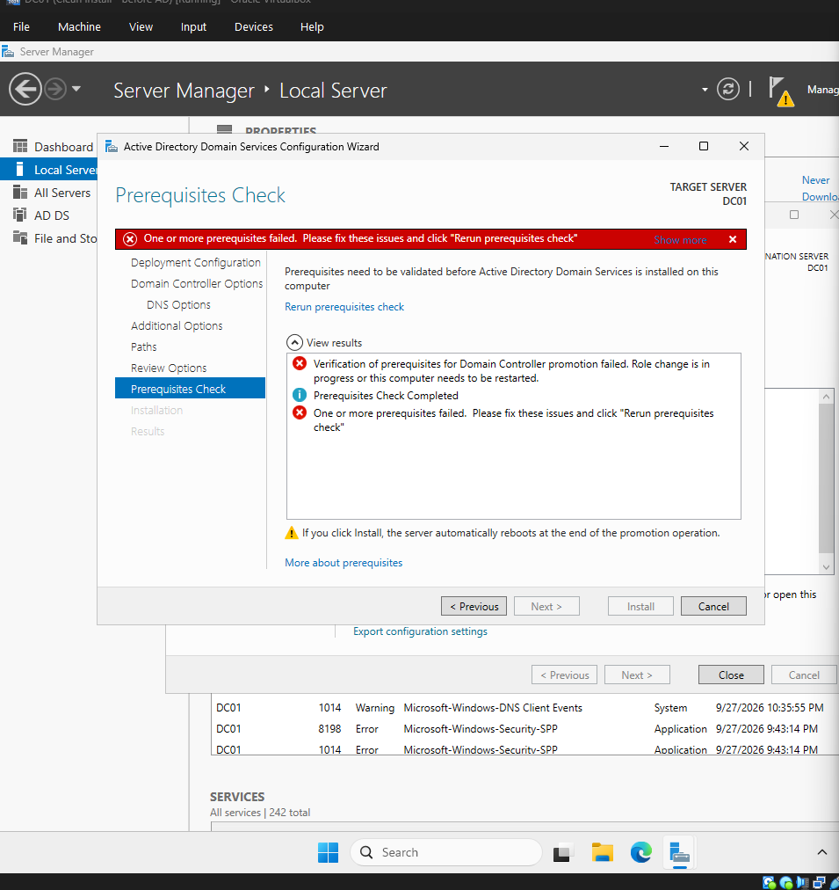

**Issue 5:** the boot prompt was missed, so CLIENT01 tried the empty disk.

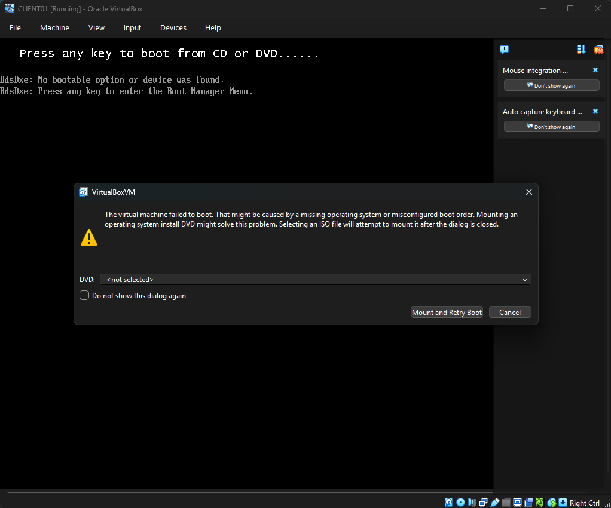

**Issue 6:** DNS timed out while DC01 was powered off.

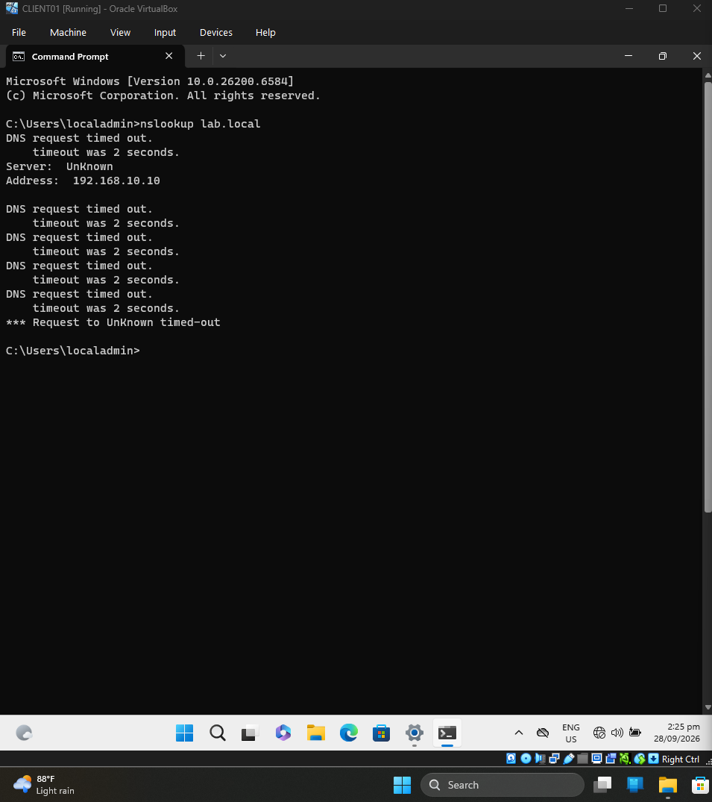

**Issue 7:** the harmless DNS name error shown after a successful join.

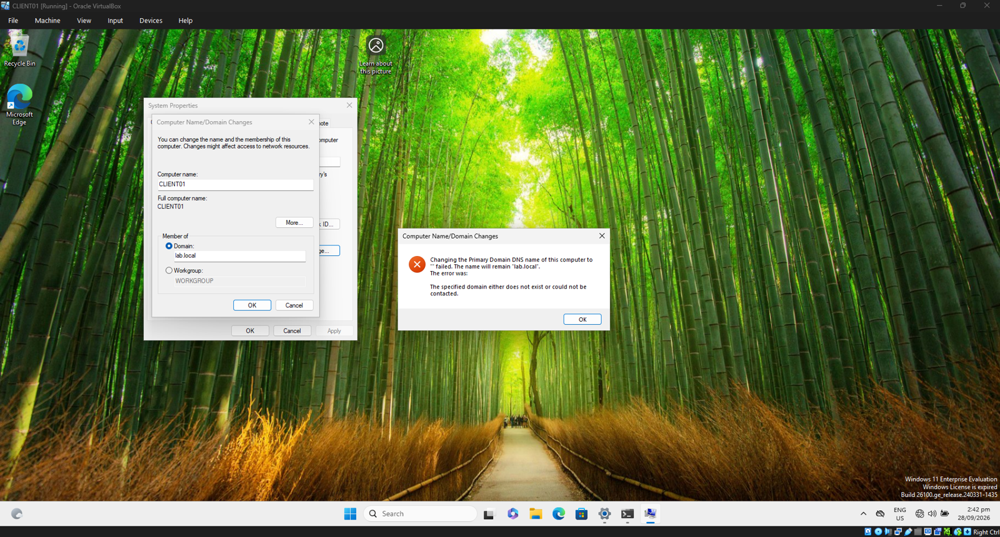

## Verification

Four checks confirm the domain works end to end, from the server side and the client side.

| Check | Where | Result |
| --- | --- | --- |
| Server is a domain controller | DC01, Server Manager > Local Server | Domain: `lab.local`; AD DS and DNS roles listed; firewall profile Domain: On |
| Client can find the domain | CLIENT01, `nslookup lab.local` | Resolves to 192.168.10.10 |
| Computer joined the domain | DC01, ADUC | CLIENT01 computer object present, now in `Company\Computers` |
| Domain user can log in | CLIENT01, `whoami` | `lab\jsmith` |

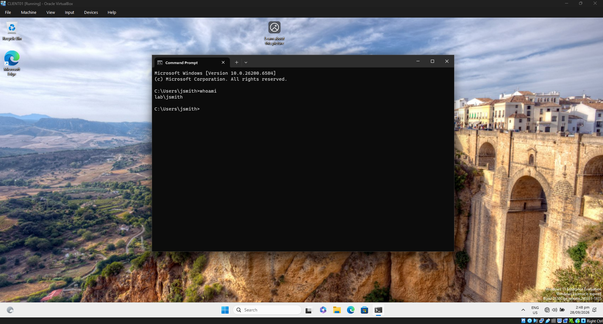

## Help desk tickets

With the domain running, I worked simulated help desk tickets end to end: verify the request, fix it, then prove the fix from the user's side.

| Ticket | Request | Resolution | Skill |
| --- | --- | --- | --- |
| #1001 | John Brown (Sales) forgot his password | Temporary password, must change at next logon | Password reset |
| #1002 | New Sales Rep, Maria Garcia, starts Monday | Account in the Sales OU with Sales-Staff access, title, department and manager set | Onboarding |
| #1003 | Jane Smith (HR) locked out | Added a domain lockout policy, then unlocked her account | Lockout policy and unlock |
| #1004 | Alex Lee (IT) leaving today | Account disabled, groups removed, moved to Disabled Users, reason recorded | Offboarding |
| #1005 | Sales needs a private shared folder | `\\DC01\Sales` share, access granted through FS-Sales-Modify (AGDLP) | File shares and NTFS permissions |
| #1006 | Sales keeps forgetting the share's address | GPO linked to the Sales OU maps it as S: at login | Group Policy drive mapping |
| #1007 | nslookup shows "Server: UnKnown" | AD-integrated reverse lookup zone with PTR records | DNS reverse lookups |
| #1008 | Four new starters across Sales and HR | PowerShell script creates accounts from HR's CSV | PowerShell bulk onboarding |
| #1009 | Accounts missing title and department | Found with a `Where-Object` audit, fixed with `Set-ADUser`, re-verified | PowerShell auditing and bulk edits |
| #1010 | Security audit: all admin work done as built-in Administrator | Named `adm-` admin account in its own OU; built-in account kept as break-glass | Privileged account management, UAC |

### #1001: Password reset

John had forgotten his password after vacation. I reset it in ADUC to a temporary password and ticked **User must change password at next logon**, so IT never knows his real password. In a real environment the caller's identity is verified first, so nobody can reset someone else's password by impersonating them.

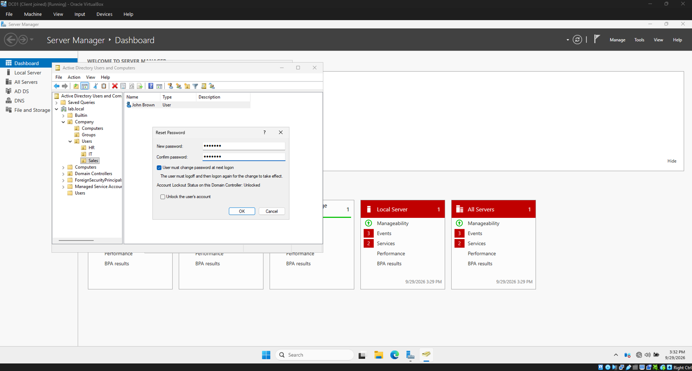

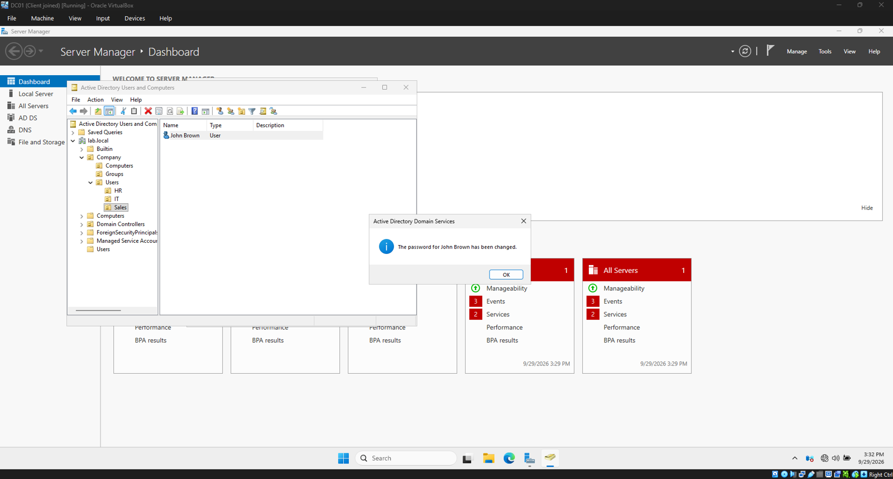

At his next sign-in, Windows forced John to choose a new password before letting him in.

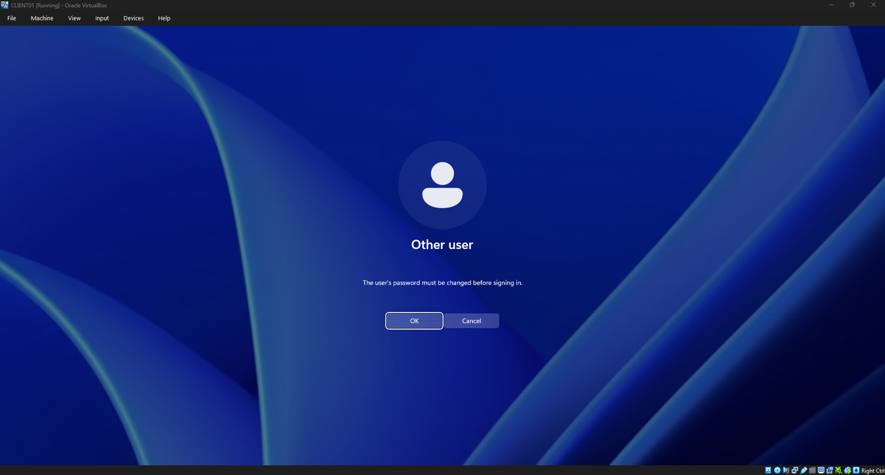

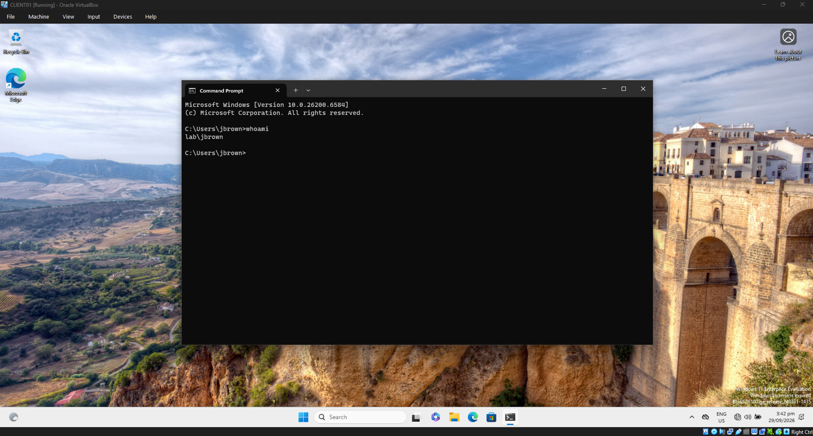

### #1002: New hire onboarding

Sales manager Karen Mills asked for a new Sales Rep, Maria Garcia, with the same access as the rest of Sales. Karen didn't exist in AD yet, so I created her first, then created Maria (`mgarcia`) in the Sales OU. I added Maria to **Sales-Staff** and set her job title, department (Sales) and manager (Karen Mills). These profile fields feed org charts and address books, and AD fills in Karen's Direct reports automatically.

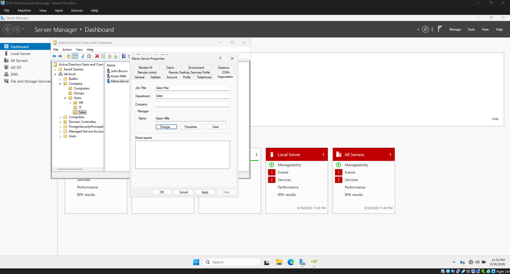

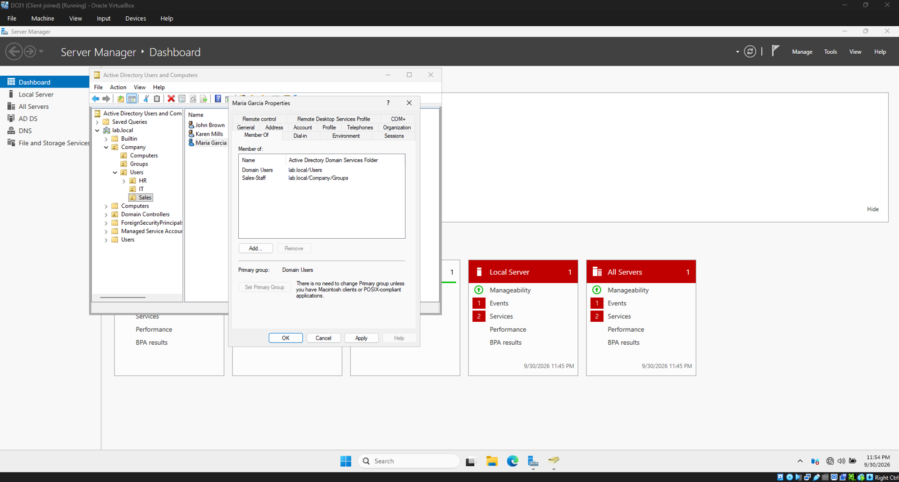

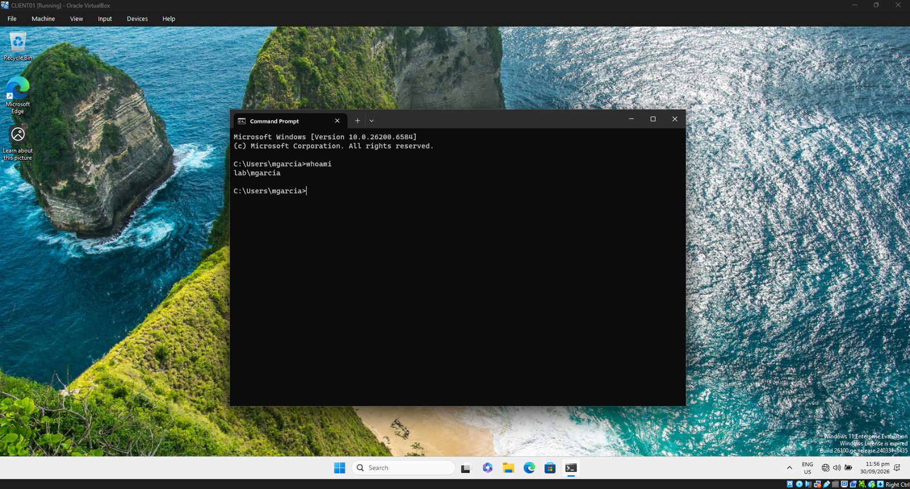

### #1003: Account lockout

Jane reported being locked out, but the domain had no lockout policy, so unlimited wrong guesses were possible. I set one in the **Default Domain Policy**: lock after **5** invalid attempts, for **15 minutes**, with the counter resetting after **15 minutes**. I left Allow Administrator account lockout enabled, since the built-in Administrator is the most-guessed account. After applying it with `gpupdate /force`, I unlocked Jane and confirmed she could sign in. Before unlocking anyone, it's worth asking why the lockout happened: repeat lockouts usually mean an old saved password is retrying somewhere.


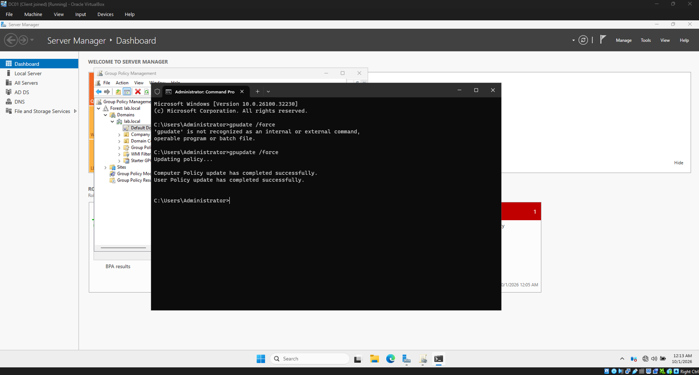

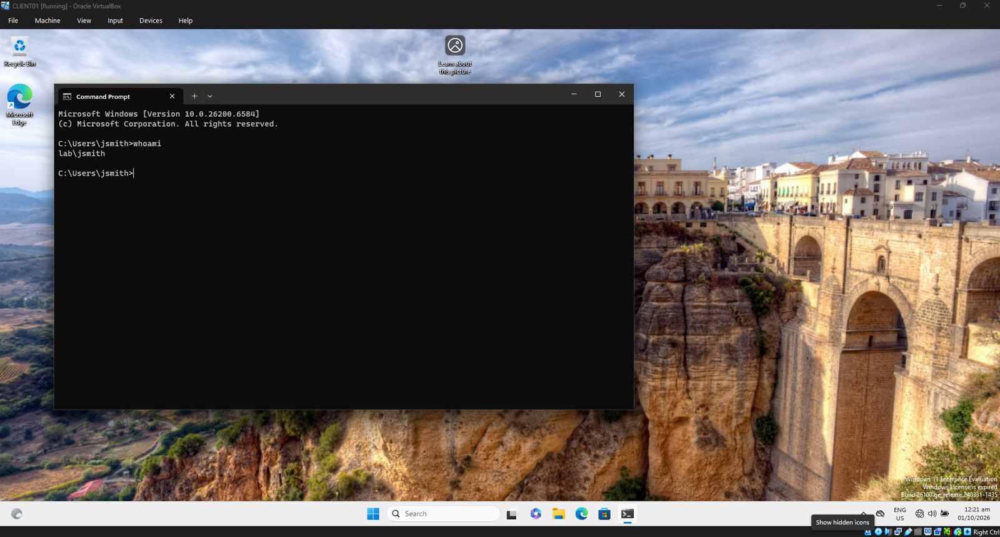

### #1004: Leaver offboarding

HR asked for Alex Lee's access to be removed on his last day, without deleting anything his manager might need. I **disabled** the account rather than deleting it: deletion is permanent and breaks the links to his files and permissions, so companies delete only after a retention period. I removed him from IT-Staff, leaving only Domain Users (his primary group), so the account would grant nothing even if re-enabled by mistake. I then created a **Company\\Disabled Users** OU and moved him into it, keeping leavers in one place for auditing.

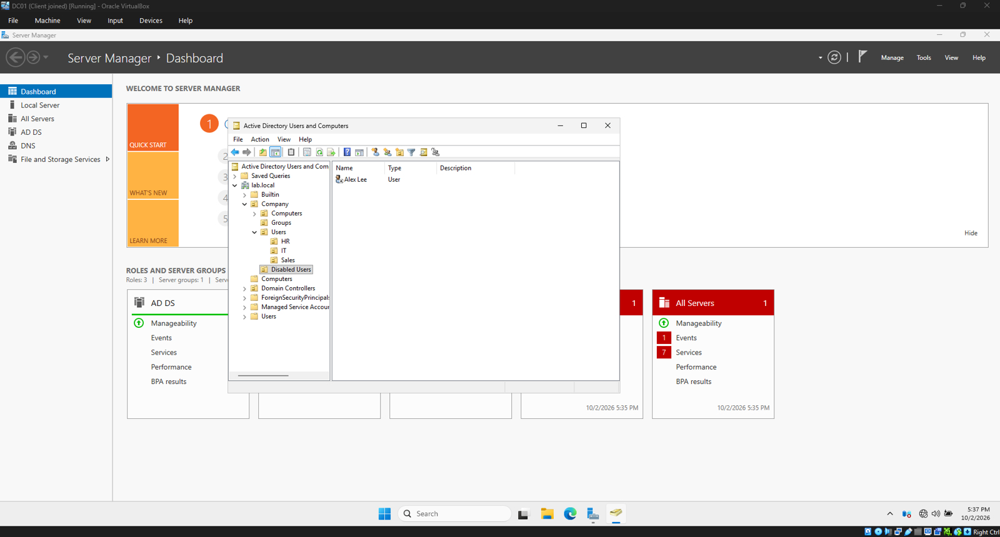

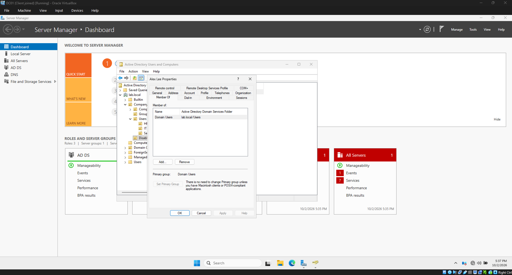

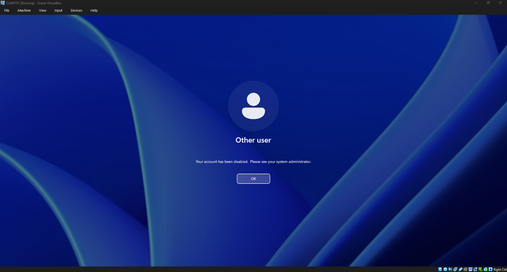

Alex's account Description was later set to `Disabled 2026-10-01 - Ticket #1004 - left company` (in #1009), so anyone who finds the account knows why it exists and when it was disabled.

### #1005: Department file share

Sales manager Karen Mills asked for a shared folder only her team could use. I built it with the **AGDLP** model: **A**ccount → **G**lobal group → **D**omain **L**ocal group → **P**ermission. Maria sits in Sales-Staff (a global group of people), Sales-Staff sits in **FS-Sales-Modify** (a domain local group representing access to the folder), and only FS-Sales-Modify appears on the folder. This separates "who works in Sales" from "who can edit this folder", so future access changes are group-membership edits rather than folder-permission edits, and auditing access means reading one group's members.

The folder `C:\Shares\Sales` is shared as `\\DC01\Sales`. Windows enforces two permission layers and applies the stricter one, so I opened the **share** layer to Authenticated Users (Full Control) and did the real restriction in **NTFS**. Leaving the default share permission (Everyone: Read) would have silently blocked writes. On the folder, I disabled inheritance (converting the inherited entries so Administrators and SYSTEM stayed), removed the inherited **Users** entries that would have let every domain user in, and granted FS-Sales-Modify **Modify** rather than Full Control, so users can't change permissions (least privilege).

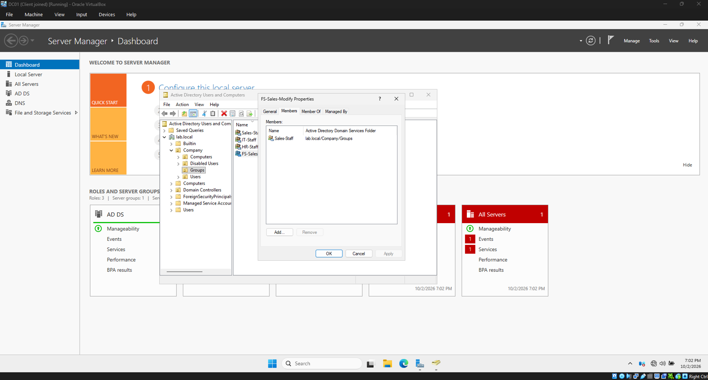

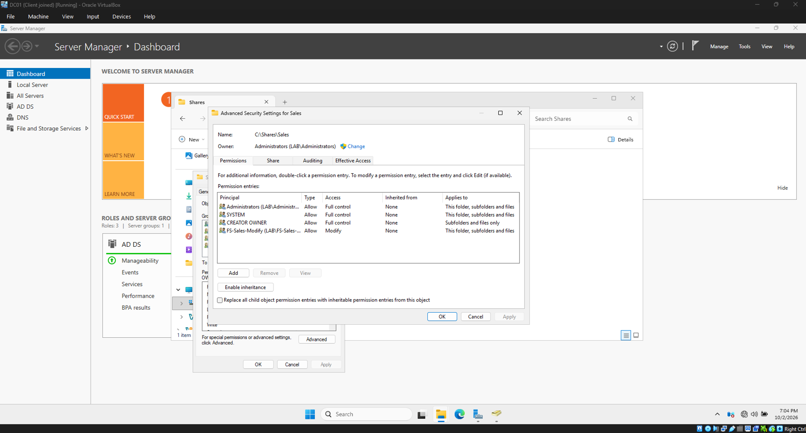

Testing covered both directions. Maria could create a file, which proves write access over the network, through both layers.

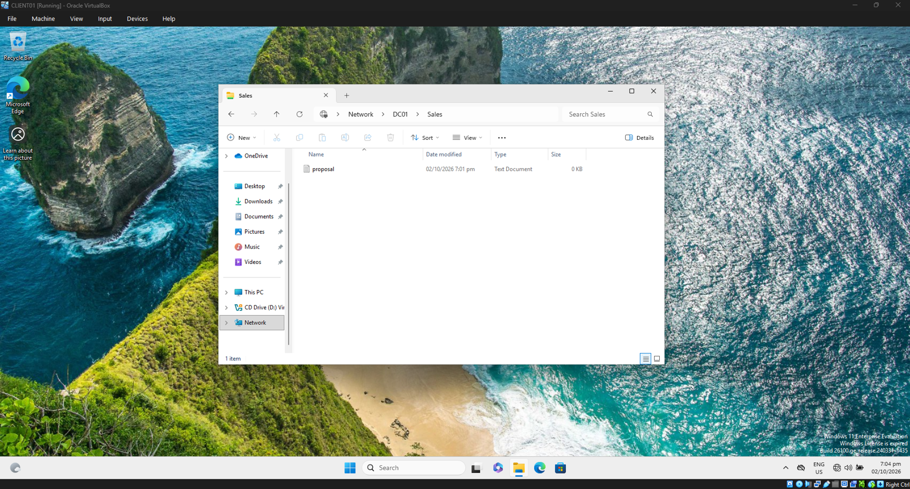

The negative test: Jane (HR) was refused by the NTFS layer, since no entry on the folder matches her groups.

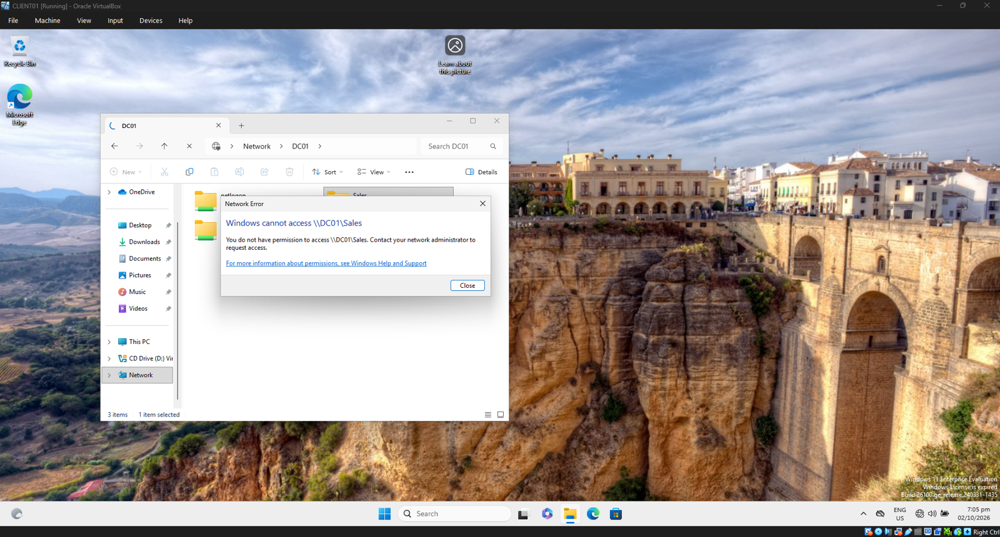

### #1006: Mapped drive with Group Policy

Sales staff kept forgetting the `\\DC01\Sales` address, so I pushed the share to them as drive **S:** with a Group Policy Object (GPO), a named bundle of settings the domain controller applies to everything in the OU it's linked to.

I created `Sales - Map S Drive` and linked it to the **Company\\Users\\Sales** OU, so only Sales users receive it; the name states who it targets and what it does. The drive map sits under **User Configuration**, so it follows the person to any PC, and under **Preferences**, the only place drive maps exist (they replaced older `net use` logon scripts). I chose the **Update** action, which creates the drive if missing and corrects it if it exists, unlike Replace, which tears it down at every refresh.

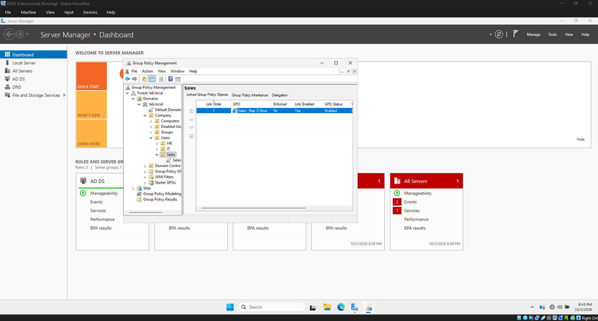

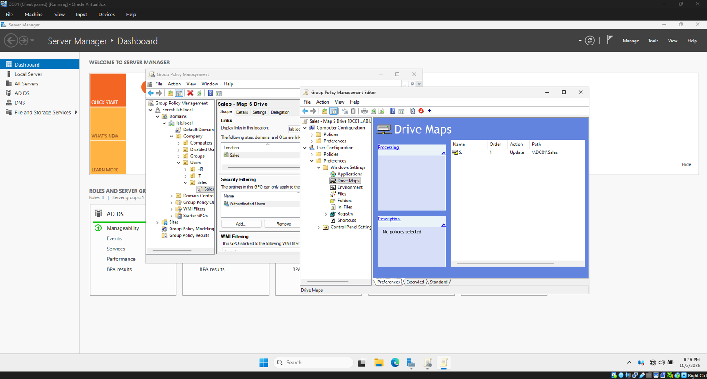

The drive appeared for Maria at her next sign-in without running `gpupdate /force`, because Group Policy applies at every login as well as in a background refresh roughly every 90 minutes. Jane, in the HR OU, received no drive, confirming the GPO's scope.

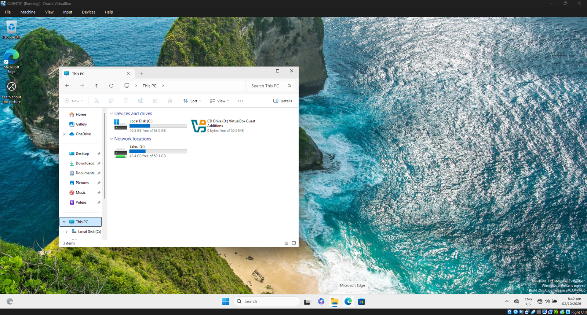

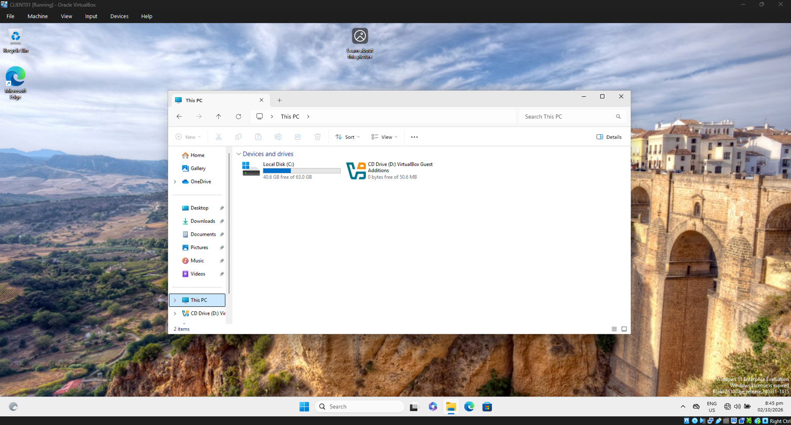

A drive map is a convenience, not a security control: if it reached Jane by mistake, the NTFS permissions from #1005 would still deny her.

### #1007: DNS reverse lookup zone

`nslookup` on the clients reported **Server: UnKnown** and timed out before answering. Forward lookups (name to IP, via A records) worked, but there was no **reverse lookup zone** to turn an IP back into a name (via PTR records), so nslookup couldn't name the DNS server it was talking to. Reverse lookups also matter for logs and security tools that record only IP addresses.

I created a primary, **AD-integrated** reverse zone, so its records replicate to future domain controllers automatically. I set replication to all DNS servers in the domain and allowed **secure dynamic updates only**, so only authenticated domain computers can register or change their own records, and a rogue device can't claim a server's name.

My first attempt failed: I typed the network ID as `192.68.10` instead of `192.168.10`, creating the zone `10.68.192.in-addr.arpa`. Creating DC01's PTR record then failed with "the referenced reverse lookup zone cannot be found", because DNS looked for `10.168.192.in-addr.arpa`. Zones can't be renamed, so I deleted the zone and recreated it, this time checking the zone name on the wizard's summary page before finishing.

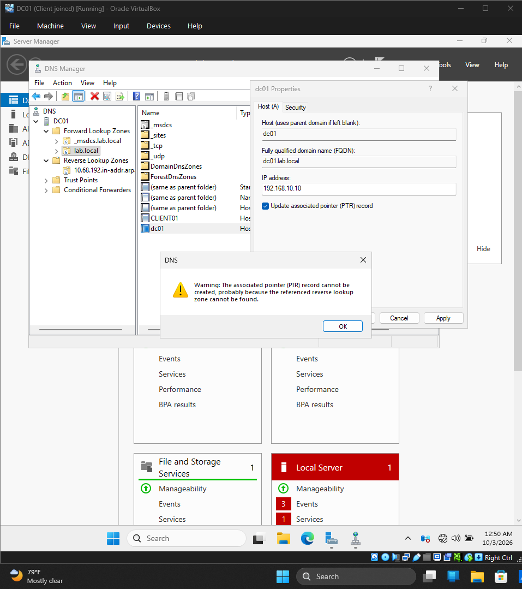

With the zone correct, I created PTR records for DC01 and CLIENT01 from their existing A records, which guarantees the name and IP match.

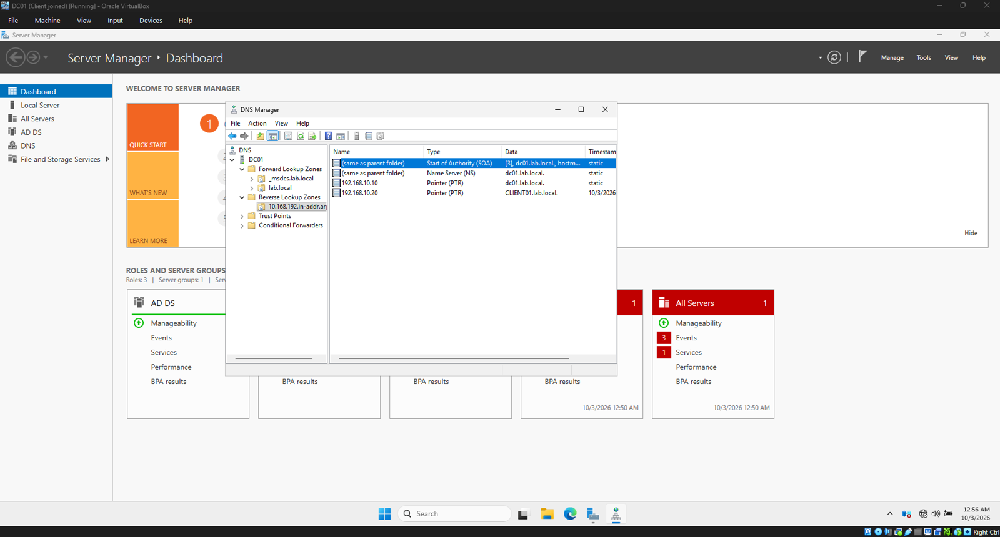

`nslookup lab.local` now names the server as dc01.lab.local, and a direct reverse lookup of 192.168.10.20 returns CLIENT01.lab.local.

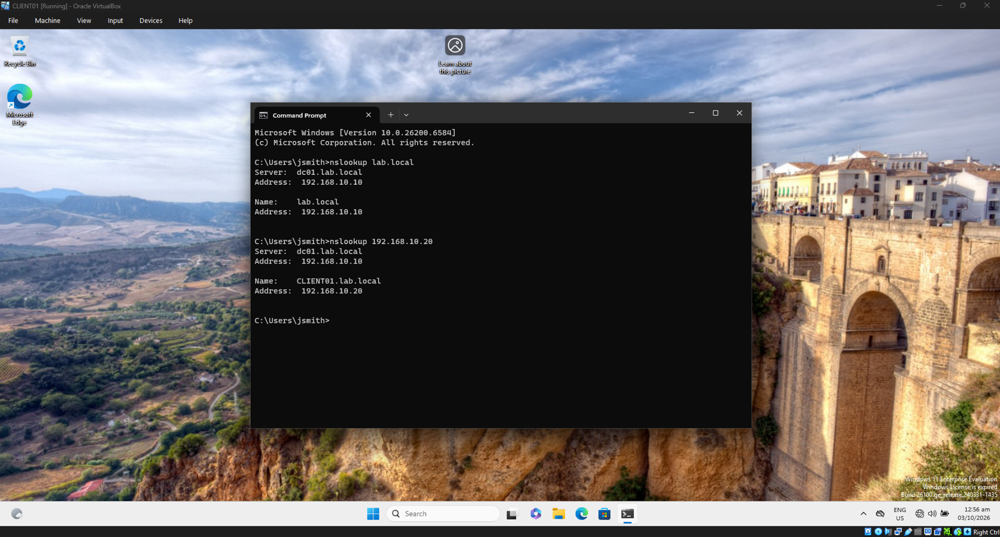

### #1008: Bulk onboarding with PowerShell

HR sent four new starters across Sales and HR. Rather than creating them by hand, I scripted it, so the same steps scale to any number of people, every field is filled identically, and the script itself records what was done.

I saved HR's list as `C:\Scripts\newhires.csv`, adding a Username column following the first-initial-plus-surname convention, and checked it with `Import-Csv` before changing anything. The script below loops over each row, builds the target OU's distinguished name from the Department column, creates the account with splatted parameters, and adds it to the matching `<Department>-Staff` group, which only works because group names follow a consistent convention. The temporary password is prompted for at run time and never stored in the file. `New-ADUser` creates accounts disabled by default, so the script sets `Enabled` explicitly.

```powershell
$password = Read-Host "Temporary password for new starters" -AsSecureString
$users = Import-Csv "C:\Scripts\newhires.csv"

foreach ($u in $users) {
    $ou = "OU=$($u.Department),OU=Users,OU=Company,DC=lab,DC=local"

    $params = @{
        Name                  = "$($u.FirstName) $($u.LastName)"
        GivenName             = $u.FirstName
        Surname               = $u.LastName
        DisplayName           = "$($u.FirstName) $($u.LastName)"
        SamAccountName        = $u.Username
        UserPrincipalName     = "$($u.Username)@lab.local"
        Title                 = $u.Title
        Department            = $u.Department
        Path                  = $ou
        AccountPassword       = $password
        ChangePasswordAtLogon = $true
        Enabled               = $true
    }

    New-ADUser @params
    Add-ADGroupMember -Identity "$($u.Department)-Staff" -Members $u.Username
    Write-Host "Created $($u.Username) in $($u.Department)"
}
```

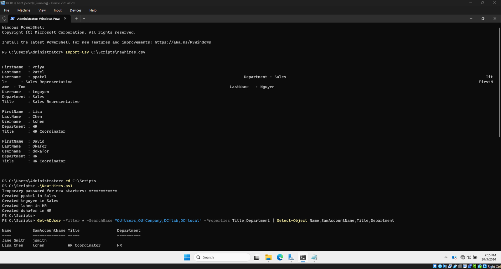

A `Get-ADUser` audit confirmed each account's title and department, and `Get-ADGroupMember` confirmed the group memberships. The audit also exposed that the two earliest hand-made accounts, Jane Smith and John Brown, had no title or department, which is the kind of inconsistency PowerShell audits catch and manual clicking misses.

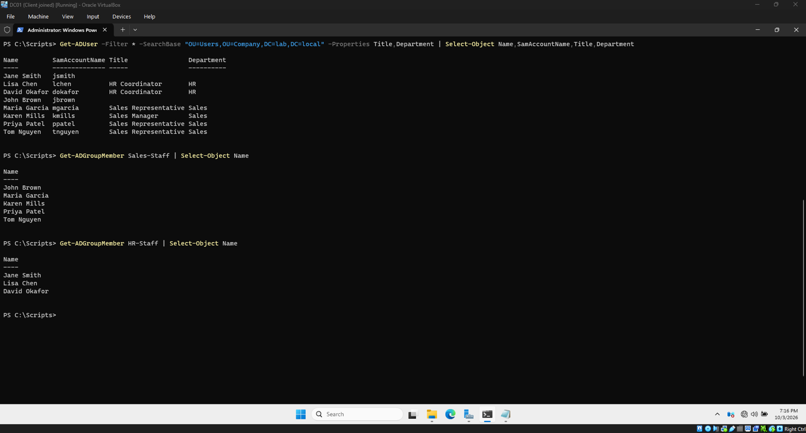

The real test was Priya Patel's first login. Without any per-user setup, she received the S: drive (from the Sales OU's GPO, #1006) and could open it (through Sales-Staff → FS-Sales-Modify, #1005). Once the structure is right, onboarding is just creating the account in the right OU and group.

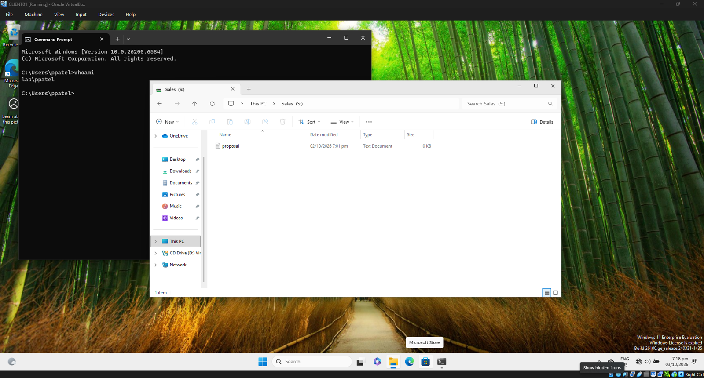

### #1009: Auditing and fixing account data

The #1008 audit showed accounts with no title or department, which makes people vanish from HR reports and the address book. Rather than fixing the two names I already knew, I searched for the condition itself, so any other incomplete account would surface too:

```powershell
Get-ADUser -Filter * -SearchBase "OU=Users,OU=Company,DC=lab,DC=local" -Properties Title,Department |
    Where-Object { -not $_.Title -or -not $_.Department } |
    Select-Object Name,SamAccountName,Title,Department
```

It returned Jane Smith and John Brown. My first fix contained a mistake: the second `Set-ADUser` targeted `jsmith` instead of `jbrown`, overwriting Jane's new values and leaving John blank. Rerunning the same search is the step that catches this kind of error. I corrected both accounts, and the rerun search returned nothing. The mistake changed only a descriptive field; access was never affected, because it comes from group membership and OU placement, not profile attributes. In the same session I recorded why Alex Lee's account is disabled (#1004).

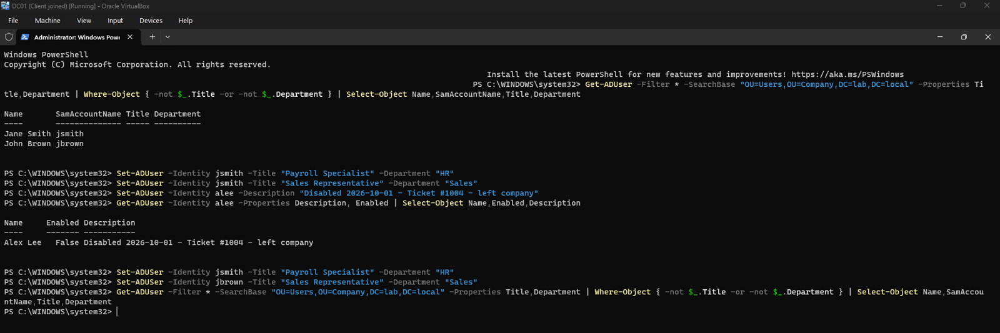

Lesson: a check only finds what it's designed to look for. The blank-field search proves nothing is missing, but not that values are correct; reading changed accounts back covers that.

### #1010: Named admin accounts

A simulated security audit found all admin work being done as the built-in **Administrator**. That account is shared (so logs can't say which person acted), is the first account attackers target, and by default bypasses UAC, so everything it runs has full rights.

I created a **Company\\Admin Accounts** OU, kept beside Company\\Users rather than inside it so user-targeted GPOs never reach admin accounts, and a named admin account, `adm-zramkissoon`, added to Domain Admins. The `adm-` prefix makes privileged accounts obvious in logs and easy to find with a script. The built-in Administrator stays enabled as a **break-glass** account for emergencies only.

My first `New-ADUser` attempt failed. Pasting lost the line breaks, so the line-continuation backticks landed mid-line, where a backtick instead escapes the next character, turning `-SamAccountName` into plain text ("A positional parameter cannot be found"). The OU path also had `OU-` instead of `OU=`. I reran it as a single line with no backticks.

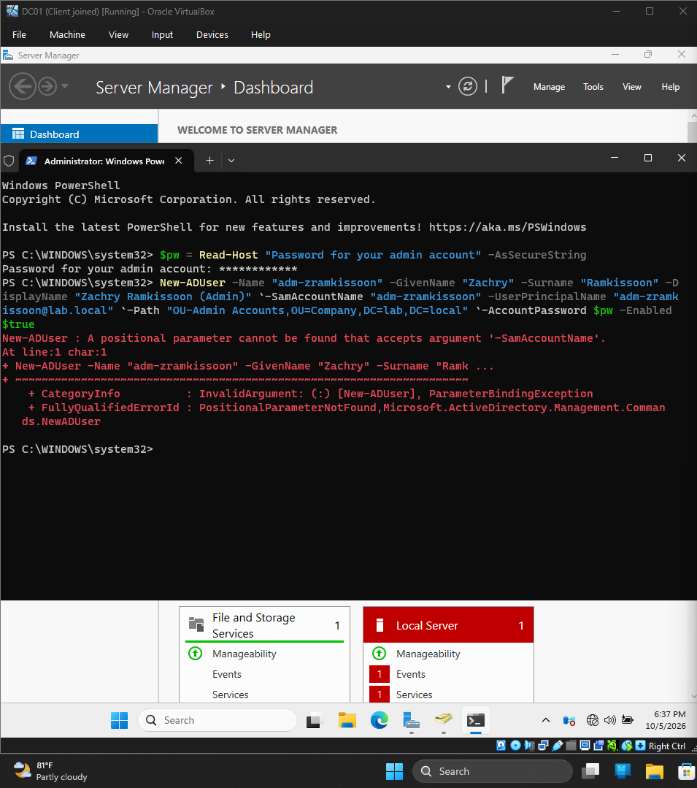

Signed in as the new account, `whoami /groups` showed UAC at work. In a normal window, Domain Admins is present but marked **Group used for deny only**, so its rights are inactive.

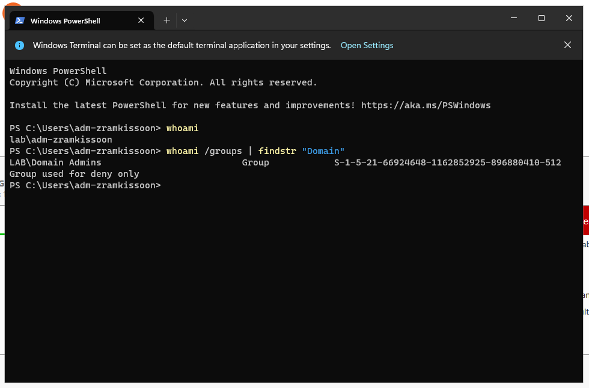

In an elevated window, the same group is **Enabled**. Admin rights apply only where I deliberately elevate.


The group's SID ends in **512**, the fixed identifier for Domain Admins in every domain; the built-in Administrator is always **500**, which is part of why it's such a predictable target.

## Linux server build: HELPDESK01

HELPDESK01 is an Ubuntu Server 26.04 LTS VM at 192.168.10.30 that will host the osTicket help desk, managed over SSH from CLIENT01. I chose an LTS release for five years of security updates, and the Server edition without a desktop, which runs in 2 GB of RAM and is managed the way real Linux servers are.

| Setting | Value | Why |
| --- | --- | --- |
| vCPU / RAM / disk | 2 / 2 GB / 25 GB | Enough for a web server and database without a GUI |
| Adapter 1 | NAT, DHCP (10.0.2.15) | Outbound-only internet for package downloads; nothing can reach in |
| Adapter 2 | labnet, static 192.168.10.30/24, no gateway | Fixed address on the lab network; one default route, via NAT |
| DNS | 192.168.10.10, search domain `lab.local` | Split DNS: lab names resolve via DC01, everything else via NAT |
| Storage | LVM, whole disk | Volumes can be grown later without reinstalling |
| Remote access | OpenSSH server | Encrypted remote administration |
| Admin account | Local user with sudo | Elevate per command instead of logging in as root |


The first install attempt hung for nearly an hour at "Loading essential drivers." The Ubuntu installer runs entirely from RAM, so I raised the VM to 4 GB for the install only, and disabled 3D acceleration, a common cause of Linux boot hangs in VirtualBox. The second attempt booted normally. During installation the kernel logged a "soft lockup" warning, meaning a virtual CPU was starved of host CPU time for 39 seconds; it was non-fatal and pointed to a busy host rather than a fault. After installing, I patched the system and returned the RAM to 2 GB.


The SSH session from CLIENT01 confirms the static lab address works, the host key was verified and recorded on first connection, and no updates are outstanding.

### osTicket help desk on a LAMP stack

osTicket 1.18.4 now runs on HELPDESK01 at `http://helpdesk01.lab.local`, with the staff panel at `/scp/`. It sits on a LAMP stack: Linux, Apache, MariaDB and PHP.

**Compatibility check first.** osTicket 1.18.4 supports PHP 8.2 to 8.4, but Ubuntu 26.04 ships PHP 8.5. Rather than install an unsupported version, I added the signed packages.sury.org repository, with its key scoped to that repository only via `Signed-By`, and installed PHP 8.4 explicitly, naming `php8.4-*` packages so Ubuntu's default 8.5 was never pulled in.


**Database, least privilege.** I ran `mariadb-secure-installation` (removing anonymous users, remote root login and the test database; root stays on Unix-socket authentication, so it has no password to steal) and created a dedicated `osticket` user that can connect only from localhost and only reach the `osticket` database. Logged in as that user, only `osticket` is visible.


**Web server.** osTicket's files live in `/var/www/osticket`, served by its own Apache virtual host with separate error and access logs. The config was validated with `apache2ctl configtest` before reloading. I added a DNS A record and PTR on DC01, so users reach the site by name.


**Install and lockdown.** The installer's prerequisite check passed every required item; only IMAP (email fetching, unused here) was missing. During install, Apache's account (`www-data`) owned the files so it could write the config. Afterwards I deleted the `setup` folder, so nobody can rerun the installer, and made `ost-config.php`, which holds the database password, owned by root and read-only to Apache (`0644`).


## Connecting osTicket to Active Directory

Employees and IT staff now sign in to osTicket with their domain accounts. osTicket checks every login against DC01 over LDAP, encrypted with StartTLS, using a read-only service account. I tested it end to end on 23 Oct 2026 with ticket #239263, below.

What happens when Jane signs in to the portal:

1. She types `jsmith` and her domain password.
2. osTicket connects to `dc01.lab.local` on port 389 and upgrades the connection to TLS. It trusts DC01's certificate because the lab's own certificate authority signed it.
3. It logs in (binds) as `svc-osticket` and searches `OU=Users,OU=Company,DC=lab,DC=local` for `jsmith`.
4. It binds again as Jane, with the password she typed. DC01 accepts or refuses it.
5. On her first login, osTicket creates its own record for her from her AD name and email address.

There is one account and one password per person, managed in AD. Disabling someone in AD also locks them out of the help desk.

### Finishing the install: lockdown

The installer's `setup` folder has no password, so anyone who could reach it could reinstall over the help desk. I deleted it, gave `ost-config.php` to root with mode `0644` (only root can change it; the web server can still read it), and restarted Apache. The staff panel's warning banner disappeared, and I took the snapshot "osTicket Installed and lockdown".


### Read-only service account

osTicket needs an account of its own to log in to AD and look people up. I created `svc-osticket` in a new **Company\\Service Accounts** OU, kept apart from people so it's easy to find and audit. The `svc-` prefix marks it as a service account at a glance.

- **Password never expires:** no person rotates it, and an expiry would silently break every login one day. I compensated with a long password and no extra rights.
- **User cannot change password:** only an admin can.
- **No group memberships beyond Domain Users:** ordinary users can already read the directory, which is all osTicket needs. If the password leaked, it could read user details but change nothing.

Larger environments solve the expiry problem with a group Managed Service Account (gMSA), whose password AD rotates automatically.


### Building the LDAP plugin

osTicket's "LDAP and Active Directory Authentication and Lookup" plugin has no pre-built download, so I compiled it from the official [osTicket-plugins](https://github.com/osTicket/osTicket-plugins) repository on HELPDESK01.

PHP first needs its LDAP extension. `php8.4-ldap` was already installed with the other PHP 8.4 packages, and `php -m | grep ldap` confirmed it was loaded. I named the 8.4 package explicitly so apt couldn't pull in a module for a different PHP version.


The build has two stages. `php make.php hydrate` downloads the plugin's third-party libraries, then `php -dphar.readonly=0 make.php build auth-ldap` packs the plugin into a single `.phar` archive. The `-dphar.readonly=0` flag lifts PHP's default refusal to write `.phar` files, for that one command.

Hydrate first failed with `Call to undefined function curl_init()`. The script downloads with PHP's cURL extension, which osTicket itself never needed, so it wasn't installed. Installing `php8.4-curl` fixed it, and hydrate pulled in **Net\_LDAP2**, the library that does the LDAP work.


I copied `auth-ldap.phar` into `/var/www/osticket/include/plugins/` and made `www-data`, the web server's user, its owner so osTicket can load it.


### Encrypted LDAP: a certificate authority on DC01

Windows Server 2025 refuses plain LDAP logins out of the box. Testing the service account with `ldapsearch` from HELPDESK01 returned `Strong(er) authentication required (8)`: DC01 requires every login to be signed or to travel inside TLS. Unsigned LDAP sends passwords readably and has been used in relay attacks, which is why Microsoft now enforces this by default.


I had two options: weaken DC01 with a Group Policy that stops requiring signing, or give DC01 a certificate so LDAP runs over TLS. I chose TLS, which keeps Microsoft's protection on.

After a DC01 snapshot ("Before AD CS"), I installed **Active Directory Certificate Services** and configured it as an **Enterprise Root CA** named `lab-DC01-CA`:

- **Enterprise** rather than Standalone: it publishes itself in AD, so domain-joined machines trust it automatically, and it issues certificates from templates with auto-enrollment.
- **Root**: it's the lab's first and only CA, so it sits at the top of the chain of trust.
- RSA 2048-bit key, SHA256 signatures, 5-year validity.


The CA is on the domain controller as a lab shortcut, to save RAM. In production it would run on its own server, ideally as a two-tier design with an offline root CA, so one break-in can't hand an attacker both the directory and the ability to issue trusted certificates.

`gpupdate /force` and `certutil -pulse` triggered auto-enrollment. DC01 received a **Domain Controller** certificate for `DC01.lab.local`, valid for Server Authentication, which is what turns on TLS for LDAP.


HELPDESK01 isn't domain-joined, so it had to be told to trust the CA. On CLIENT01, I fetched the CA certificate with `certutil -ca.cert`, converted it to text (PEM) with `certutil -encode`, and copied it across with `scp`.

Before trusting it, I compared fingerprints. `openssl` on HELPDESK01 and the Thumbprint on DC01 both read `EE:57:0F:…:9E:19`, proving the file was the genuine CA certificate and hadn't been altered on the way.


Copying it into `/usr/local/share/ca-certificates/` and running `update-ca-certificates` added it to Ubuntu's trusted list (`1 added`).


The same `ldapsearch` with `-ZZ` (StartTLS, required) then logged in as svc-osticket and found Jane Smith: `result: 0 Success`.


### Plugin settings, and the freeze on save

Every attempt to save the plugin's settings froze HELPDESK01 for minutes at a time. The console showed both virtual CPUs stalled, one of them inside Apache. Because the whole VM froze, nothing reached Apache's error log.


I tested each link in the chain separately. `nslookup -type=SRV _ldap._tcp.lab.local` found DC01, and `nc -zv dc01.lab.local 389` reached its LDAP port, so DNS and the network were fine.


That left osTicket's side, which hid two separate problems:

1. DC01 refused plain LDAP logins. That was fixed by the CA and TLS above.
2. The save still froze with TLS working. With **LDAP servers** left blank, the plugin finds the domain controller itself through an old bundled DNS library, rather than Ubuntu's normal lookup. On PHP 8.4 that code spun the CPU. Naming `dc01.lab.local` in **LDAP servers** skips it, and the save then succeeded instantly.

Neither fix alone would have worked. Testing with `nc`, `ldapsearch` and one changed setting at a time is what separated them.

osTicket identifies portal users by email, and my users had none. Setting one for every employee was a job for PowerShell (eight users, one pattern):

```powershell
Get-ADUser -Filter * -SearchBase "OU=Users,OU=Company,DC=lab,DC=local" | ForEach-Object { Set-ADUser $_ -EmailAddress "$($_.SamAccountName)@lab.local" }
```


Alex Lee isn't in the list: his disabled account sits in Company\\Disabled Users, outside the search, which is correct for a former employee. I also added the email address to the onboarding script, so new starters get one automatically.

The final settings:

| Setting | Value | Why |
| --- | --- | --- |
| Default Domain | `lab.local` | Lets people sign in as `jsmith` rather than `jsmith@lab.local` |
| LDAP servers | `dc01.lab.local` | Named directly; auto-discovery froze the VM |
| Use TLS | On | StartTLS on port 389; DC01 refuses unencrypted, unsigned logins |
| Search User | `svc-osticket@lab.local` | The read-only service account |
| Search Base | `OU=Users,OU=Company,DC=lab,DC=local` | Only employees can sign in. Admin and service accounts sit outside it, and searching below the domain root avoids AD's referrals to its other partitions |
| LDAP Schema | Microsoft Active Directory | AD's layout for names and email |
| Staff / Client authentication | Both on | IT staff and employees both use domain logins; local osTicket accounts still work as a fallback |


osTicket has two switches, one per plugin and one per instance. The plugin itself also had to be set to **Enabled**.


### Ticket #239263: Jane needs the Sales folder

The first real ticket went through the whole access lifecycle in 50 minutes: request, approval, read-only grant, verification, revocation, verification again, then resolved. Every decision is recorded in the ticket.

**Request.** Jane (HR) signed in to the portal as `jsmith` with her domain password. osTicket filled in her name and `jsmith@lab.local` from AD; nobody created an osTicket account for her. She asked for access to the Sales shared folder for a payroll report.


**Triage.** I claimed the ticket so it had a named owner, then recorded my reasoning in an **internal note**, which staff can see and Jane can't. Sales data belongs to its **data owner**, the Sales Manager Kevin Mills. Access isn't granted just because someone asks, and `FS-Sales-Modify` would let her edit and delete files when she likely only needs to read. I replied asking her to confirm the scope. The Default SLA set a due date of 27 Oct.


**Approval.** Jane confirmed view-only. Kevin's approval (simulated) went into an internal note with its scope and end condition, so the ticket proves why HR could see Sales files.


**Grant.** I created **FS-Sales-Read**, a domain local security group with only Read & execute, List folder contents and Read on `C:\Shares\Sales`, and added Jane to it. Strict AGDLP would nest a global group in between. For one approved, temporary exception, adding the user directly is an accepted shortcut; a second HR reader would justify the global group.


**Verify.** Group membership is fixed into the access token at sign-in, so Jane signed in fresh. She could open `\\DC01\Sales` and read `proposal.txt`, and creating a file failed with "Destination Folder Access Denied". She has no S: drive, because the mapping GPO applies only to the Sales OU.


**Follow-up task.** The removal went into an osTicket **task** on the ticket, assigned to me with a one-week due date. osTicket then refused to resolve the ticket while the task was open: the job isn't done until access is removed.


**Revoke and verify.** When Jane said the report was finished, I removed her from FS-Sales-Read. Her already-open session could have kept access until sign-out, because her old token still listed the group. For an urgent removal, such as a dismissal, I'd also force a sign-off. After a fresh sign-in, Windows refused `\\DC01\Sales`.


**Close.** I closed the task with the evidence, replied to Jane and set the ticket to **Resolved**. Resolved means fixed; it reopens automatically if she replies. One snag along the way: a reply left unsent for 12 minutes lost osTicket's **ticket lock**, which stops two technicians answering at once. Refreshing the page took a new lock, and the auto-saved draft survived.


All three VMs were then snapshotted as "Phase 4 complete - AD login + CA".

## Hardening: HTTPS for the help desk

The help desk now runs at `https://helpdesk01.lab.local`, with a certificate from the lab's own CA, and plain HTTP redirects to it. Staff and employees type passwords into osTicket, so they shouldn't cross the network in readable form. CLIENT01 shows a padlock with no warning, because domain members trust lab-DC01-CA automatically.

HELPDESK01 isn't domain-joined, so it can't auto-enroll like DC01. I used the manual route that works for any server:

1. **HELPDESK01 makes a private key and a certificate signing request (CSR).** The key never leaves the server; the CSR carries the matching public key and the name `helpdesk01.lab.local`. I added a Subject Alternative Name, because browsers check only the SAN and ignore the Common Name. `-nodes` leaves the key without a passphrase so Apache can start unattended, which makes the file's permissions the protection.
2. **The CA signs it.** On DC01, `certreq -submit` with the **Web Server** template issued certificate #3. Only Domain and Enterprise Admins may enroll for that template, since a web certificate can claim any server name. Windows Server's built-in `scp` moved the files both ways.
3. **HELPDESK01 checks and installs it.** `openssl verify` returned OK against the trusted CA list, and the certificate's and key's modulus fingerprints matched. The certificate went to `/etc/ssl/certs` (mode 644, public by design) and the key to `/etc/ssl/private` (mode 600, root only). Apache reads the key as root at start-up, then serves traffic as `www-data`. The working copies were shredded.

My first `openssl` command named the same file for both the key and the CSR, so the request overwrote the key. I shredded the file and started again; a fresh key costs nothing.


Apache's site became two virtual hosts. Port 80 only redirects (301, permanent), including visitors who type the IP address. Port 443 serves osTicket with the certificate. The IP alias stays off the HTTPS site, because the certificate covers only the name.

```apache
<VirtualHost *:80>
    ServerName helpdesk01.lab.local
    ServerAlias 192.168.10.30
    Redirect permanent / https://helpdesk01.lab.local/
</VirtualHost>

<VirtualHost *:443>
    ServerName helpdesk01.lab.local
    DocumentRoot /var/www/osticket
    SSLEngine on
    SSLCertificateFile    /etc/ssl/certs/helpdesk01.lab.local.crt
    SSLCertificateKeyFile /etc/ssl/private/helpdesk01.lab.local.key
    <Directory /var/www/osticket>
        AllowOverride All
        Require all granted
    </Directory>
</VirtualHost>
```

I backed up the old config, enabled `mod_ssl`, and ran `apache2ctl configtest` (Syntax OK) before a full restart. `ss` then showed Apache listening on 80 and 443. `ufw` reported inactive, so HELPDESK01 has no host firewall yet; that's on the hardening list.


In osTicket, I set the **Helpdesk URL** to `https://helpdesk01.lab.local/`, which it uses to build links, and ticked **Force HTTPS**. That's defence in depth: osTicket refuses plain HTTP even if the Apache redirect were ever lost.


Jane's domain login works the same over HTTPS.


## Key concepts and next steps

The biggest lesson from Part 1: AD depends on DNS, so most join and login problems start there.

**Concepts put into practice**

- **Domain controller:** stores the directory and authenticates logins. It also runs DNS, so clients must use its IP as their DNS server.
- **OUs vs groups:** an account lives in exactly one OU, used for organizing, Group Policy and delegation. It can belong to many groups, used for granting access.
- **Rename before promoting:** renaming a domain controller after promotion is disruptive, so DC01 was named first.
- **Default containers:** new computers land in the built-in Computers container, where GPOs cannot be linked, so they're moved into a managed OU.
- **Snapshots:** taken at each milestone so the lab can be rolled back in seconds.
- **LDAP:** the protocol applications use to query a directory. AD is the directory; LDAP is how osTicket asks it who someone is and whether their password is right.
- **LDAP signing and StartTLS:** Windows Server 2025 refuses unsigned, unencrypted LDAP logins. StartTLS starts on port 389 and upgrades to TLS before any password is sent; LDAPS on port 636 is encrypted from the first byte.
- **Certificate authority and trust:** a CA signs certificates; a machine accepts a server's certificate only if it trusts the CA that signed it. Domain members trust an Enterprise CA automatically; a non-domain Linux server has to be told, after checking the fingerprint.
- **Service accounts:** a dedicated, least-privilege account for an application to log in with, never a person's or an admin's account.
- **Access lifecycle:** access to another team's data needs the data owner's approval, the smallest permission that does the job, a recorded end date, and verification both when it's granted and when it's removed.

## Roadmap

The lab grows from on-prem Active Directory into a small, connected IT environment: a Linux server running a real ticketing system, hybrid cloud identity, and an AI help desk assistant. Each phase builds on the AD foundation rather than standing alone.

| Phase | Focus | How it ties into the lab | Status |
| --- | --- | --- | --- |
| 1 | Core AD build | Domain controller, `lab.local`, OUs, users, groups, domain-joined client | Done |
| 2 | Help desk tickets #1001–#1009 | Password resets, onboarding and offboarding, lockout policy, file shares, Group Policy, DNS, PowerShell | Done |
| 3 | Admin account separation (#1010) | Named `adm-` admin accounts; built-in Administrator kept for emergencies | Done |
| 4 | Linux server and osTicket | Ubuntu Server VM hosting osTicket; staff and employees sign in with AD accounts over LDAP/TLS; first ticket worked end to end | Done |
| 4b | Hardening and clean-up | HTTPS for osTicket with a certificate from lab-DC01-CA (done); help topics routed to the Support department; a host firewall (ufw) on HELPDESK01; CLIENT01's expired evaluation licence | In progress |
| 5 | Remaining AD work, ticketed in osTicket | Delegation, DHCP, Group Policy troubleshooting, security filtering, AD Recycle Bin, second DC and replication, FSMO roles, backup and restore | Planned |
| 6 | Hybrid identity with Microsoft Entra ID | Lab users synced to the cloud for on-prem and cloud sign-in | Planned |
| 7 | AI help desk assistant | Agent triages osTicket tickets and proposes fixes; least-privilege delegated account, human approval, full logging | Planned |

The AI assistant comes last on purpose: it depends on the ticketing system's API, delegated permissions from phase 5, and PowerShell automation.
